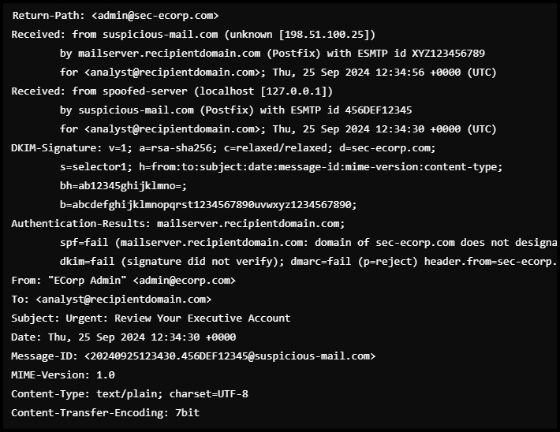
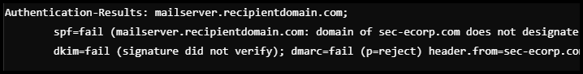
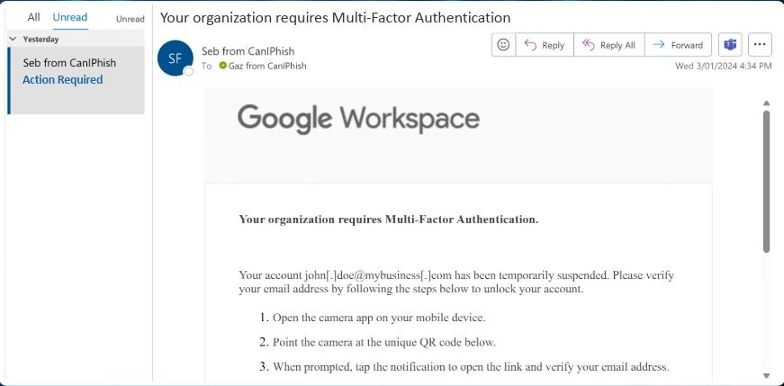
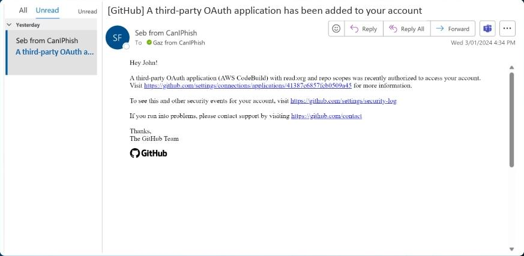
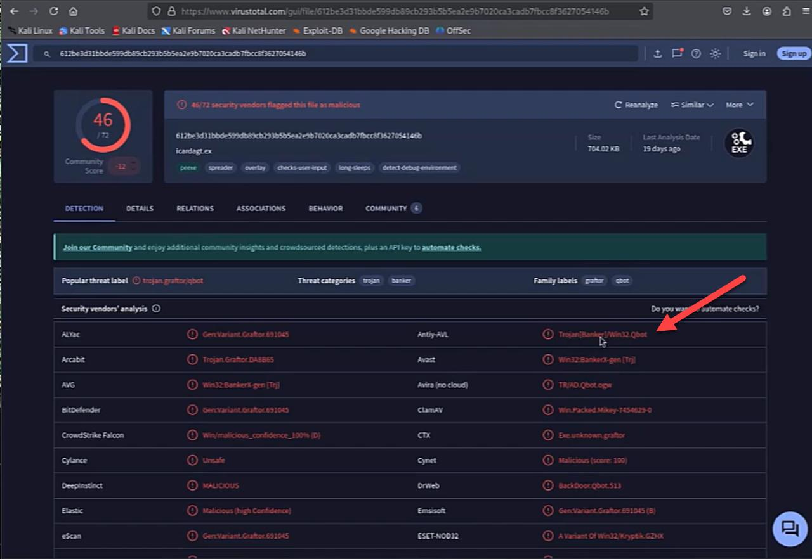
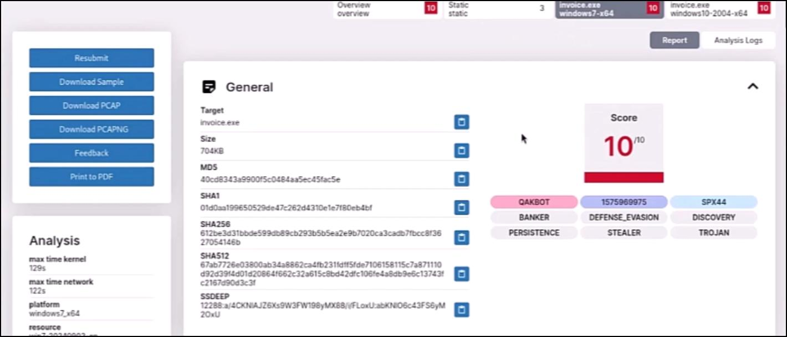

# Email & Phishing Analysis — SOC Investigation Portfolio

I analyzed email headers, reviewed **40 phishing training messages**, and triaged a suspicious executable to practice identifying email-borne threats. My work focused on **sender authentication, impersonation indicators, social-engineering lures, attachment reputation, and sandbox findings**.

This is a documented **training investigation**, not a record of production SOC incidents.

## Investigation at a glance

| Area | Tools and evidence reviewed | Findings |
| --- | --- | --- |
| **Email header analysis** | Thunderbird, Sublime Text, email-header fields, SPF/DKIM/DMARC results | Compared an authenticated marketing email with an illustrative impersonation example showing domain inconsistencies and failed authentication checks. |
| **Phishing message analysis** | 40 CanIPhish training-message screenshots | Classified credential-reset lures, QR-code phishing, fake collaboration notifications, account alerts, and attachment-based pretexts. |
| **Suspicious attachment triage** | Linux terminal, VirusTotal, ANY.RUN, Triage | Reviewed `invoice.exe` reputation and sandbox results identifying the sample as **Qbot/Qakbot**, including configuration and process information. |

## 1. Email header investigation

I compared a CrowdStrike marketing-email header with a suspicious **illustrative ECorp administrator message**. I checked the `From`, `Return-Path`, `Received`, `Message-ID`, and `Authentication-Results` fields rather than relying on the display name alone.

**What I found:**

- The marketing example showed **SPF, DKIM, and DMARC passing** in the displayed header results, with sending infrastructure consistent with the claimed domain.
- The suspicious example displayed `admin@ecorp.com`, but its `Return-Path` referenced `sec-ecorp.com` and its message route referenced `suspicious-mail.com`.
- The suspicious header showed **SPF, DKIM, and DMARC failures**, together with an urgent executive-account subject.
- The suspicious header is a **constructed training example**, not a confirmed live phishing incident. Passing authentication also does not guarantee an email is harmless.

I documented the comparison and its implications for first-line triage in the [email-header investigation](reports/01-email-header-investigation.md).

## 2. Phishing email content analysis

I reviewed **40 CanIPhish training examples** and examined how the message content attempts to persuade a recipient to click a link, scan a QR code, open a file, or enter credentials. My assessment focused on the **claimed sender, requested action, urgency, branding, and likely security risk**.

Examples of the lures I examined:

- **Google Workspace MFA QR code:** A claimed account suspension prompts QR-code verification.
- **GitHub OAuth app:** A supposed third-party authorization notification creates concern about account access.
- **Microsoft OneDrive file share:** A purported employee-performance document uses curiosity and workplace context.
- **Quarantined email notification:** A message impersonates email-security tooling to request a login.
- **Netflix password expiry:** A password-reset deadline encourages rushed action.
- **HR policy violation:** An alarming workplace allegation uses a link and attachment as bait.

These are **training-message screenshots**. I documented the visible persuasion techniques and risk indicators; I did not verify the underlying destinations or execute attachments. The [phishing-message assessment](reports/02-phishing-message-assessment.md) includes the findings and scenario coverage.

## 3. Suspicious attachment triage — `invoice.exe`

I performed **initial file-reputation and sandbox triage** of an executable presented as an invoice attachment. I generated a file hash in a Linux environment and examined results from **VirusTotal, ANY.RUN, and Triage**.

**What I found:**

- VirusTotal results in the lab material flagged the executable as malicious and associated it with **Qbot/Qakbot**.
- ANY.RUN provided a behavioral report, process information, IOC views, and ATT&CK mapping for review.
- Triage identified the sample as **Qakbot** and displayed configuration information, including a list of IP addresses, along with process activity.

These are **platform-reported results**. The available material does not establish that I blocked indicators, hunted across an enterprise network, or performed a full local reverse-engineering investigation. See the [attachment triage findings](reports/03-suspicious-attachment-triage.md).

## Investigation outcomes

- Correlated sender-domain inconsistencies with **SPF, DKIM, and DMARC** results in an illustrative impersonation case.
- Documented social-engineering techniques across **40 phishing training scenarios**.
- Used file reputation and automated sandbox reports to classify a suspicious attachment and identify areas for further SOC investigation.
- Identified practical next steps: preserve the original message, validate suspicious URLs and indicators in approved tools, and escalate or contain threats **when supported by evidence and organizational procedures**.

## Evidence scope and safe handling

This repository contains **screenshots and written analysis**, not raw `.eml` messages, exported sandbox artifacts, enterprise alert records, or live malware binaries. The header impersonation example uses illustrative domains and a documentation-only IP address. Screenshots of training messages do not establish that a link was clicked or that credentials were compromised.

**No malware executables are distributed here.** Any further sample analysis should be performed only in an authorized, isolated environment.
